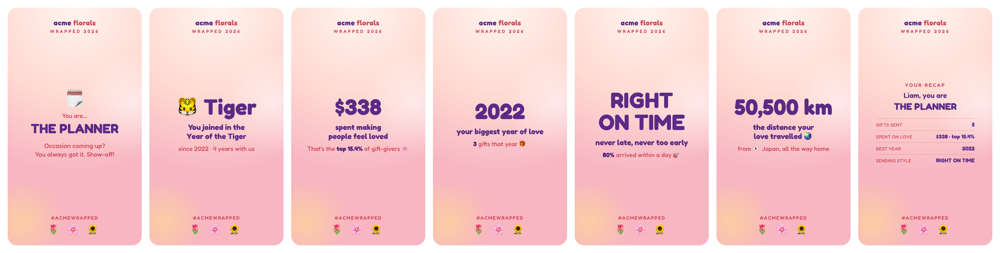
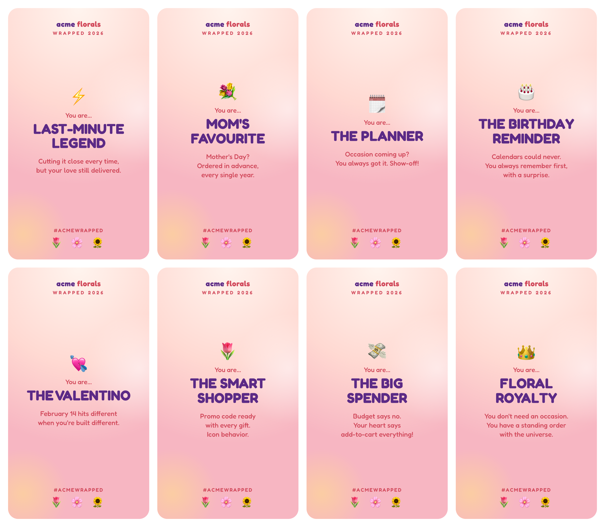

# Customer Wrapped

A "Spotify Wrapped" for a shop's customers: every customer gets a personal set of shareable
9:16 cards built from their own order history, ready to send by email.



Each customer is matched to one of **eight archetypes** from how they actually buy, then gets only
the stat cards their history supports:



| Card | Shown when |
|---|---|
| Zodiac year | always: the year they joined, tenure, and "top X% longest-loving" when it is true |
| Spend | lifetime spend is above a floor (no "$3 spent making people feel loved") |
| Best year | always |
| Sending style | Type A (days ahead), Type B (same day) or Right On Time, from real lead times |
| Distance travelled | they paid from abroad: cumulative km across every country they sent from |
| Most romantic hour | at least a third of their orders were placed between 11 PM and 6 AM |
| Summary | always |

## Built for a real campaign

This ran for a florist's birthday campaign over **1.3 million orders and about 430,000 customers**.
Most of the work was in the rules, not the rendering, and every rule in `rules.py` is there because
of something the real data did:

- **Sympathy orders never count.** Funeral and condolence orders are excluded from every stat, and
  a customer with only those gets no email at all. The first product pattern caught 2,066 such
  orders and missed 5,939, because catalogs name them euphemistically ("In Loving Memory",
  "Beautiful Farewell"); it also flagged Christmas wreaths. The final rule reads products and card
  messages.
- **Only people, only mailable.** Business domains, role addresses (`info@`, `orders@`),
  disposable domains and typo domains (`gmail.con` alone was 2,063 addresses) are dropped or
  repaired only when the correction is unambiguous.
- **Names are cleaned.** ALL CAPS, honorifics ("Dr. Ava" greets Ava), placeholders and handles
  fall back to "Hi there".
- **No claim the data cannot support.** One order states the event ("your gift flew out
  same-day"), never a pattern ("100% of orders"). A no-signal customer is never handed the loyalty
  crown: that default once took 59,263 people, 54,071 of them with a single order.
- **Deterministic.** No randomness, customers sorted by a hash of their email: the same input
  gives byte-identical output and the same image filenames, so a rerun resumes and overwrites
  nothing by accident.

## Quick start

```bash
git clone https://github.com/rodrig0055/customer-wrapped && cd customer-wrapped
python3 examples/make_orders.py                        # 800 invented customers, ~2,500 orders
python3 compute.py examples/orders.csv                 # out/customers.jsonl
npm install && LIMIT=50 node render.js                 # out/pngs/<cid>_<NN>_<key>.png
IMAGE_BASE_URL=https://cdn.example.com/wrapped python3 manifest.py   # email merge file + template
```

Python needs only the standard library. `render.js` uses Puppeteer (set `PUPPETEER_EXEC` to use an
installed Chrome), renders with a page pool (`RENDER_CONCURRENCY`, default 6) and skips customers
whose images exist, so a large run can stop and resume.

## Your own shop

- **Orders**: one row per delivered order with `order_id, email, first_name, created_at, delivery_date,
  total, items, message, sender_country`. Times are local time.
- **Brand**: colours, wordmark and hashtag are tokens at the top of `template.html`. Email clients
  strip web fonts, which is why every word is baked into the image.
- **Copy and thresholds**: archetypes and card copy are in `compute.py`; `CURRENCY_SYMBOL`,
  `SPEND_FLOOR`, `OWN_DOMAINS` and `HOME_COUNTRY` are environment variables.
- **Sending**: `manifest.py` writes fixed image slots per row (a missing card points at a
  transparent pixel) and a pre-rendered greeting, because most email platforms have no
  conditionals.

## Tests

```bash
uv run --no-project --with pytest pytest -q
```

## License

MIT
